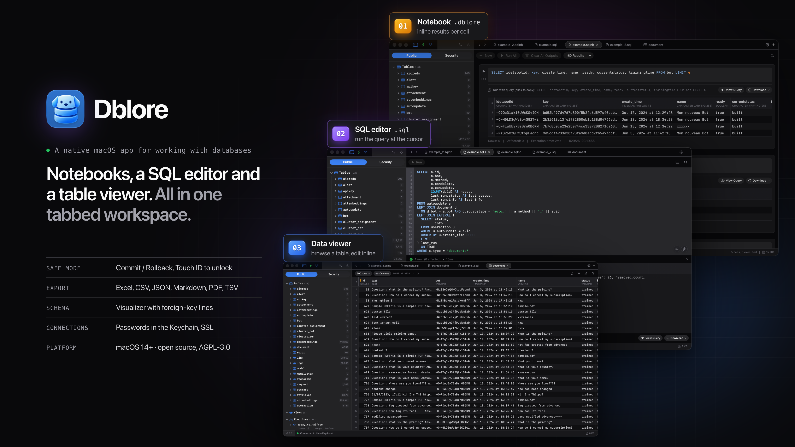

<div align="center">


# Dblore

A native macOS database client: query in Jupyter-style **notebooks** or a classic
**SQL editor**, browse and edit results and tables, explore the schema, guard production
with Safe Mode, and get help from an AI assistant that works with your own key or a local
model. Supports PostgreSQL, MySQL/MariaDB, MongoDB, SQLite and DuckDB (as a plugin).

[Download](https://github.com/dinhanhthi/Dblore/releases/latest) &nbsp;·&nbsp; [Website](https://dblore.dinhanhthi.com)
&nbsp;·&nbsp; macOS 14+ &nbsp;·&nbsp; signed &amp; notarized

</div>

> [!NOTE]
> Dblore is built around my own day-to-day needs, so many features are still missing.
> Need something? [Suggest a feature](https://github.com/dinhanhthi/Dblore/issues/new?template=feature_request.md&title=New%20feature%3A%20&labels=enhancement) and I'll consider adding it. You can check all available features [here](https://dblore.dinhanhthi.com/features.html).



## Features

- **Notebooks and SQL editor**: `.dblore` notebooks with inline results, plain `.sql` tabs
  and quick Markdown notes, in one tidy workspace. Autocomplete knows CTE columns, offers
  select-list aliases after ORDER BY and the foreign-key condition after a join's ON, and also
  matches names in the middle (`ord` finds `purchase_orders`). Format SQL follows your indent,
  case, comma and line-width rules, and View > Zoom resizes the focused editor, grid or schema
  diagram. Bookmark lines in a SQL tab with `Cmd+F2` or a gutter click, jump with `F2` and
  `Shift+F2`; bookmarks are saved with the workspace
- **Schema browser**: tables, columns and types, a quick filter and a canvas with foreign-key
  lines that you can copy or save as Mermaid or Graphviz DOT. Group tables and views into
  sidebar folders, hide schemas you do not use, and find a value in the text of every table.
  A Temporary section lists the session's temp tables. PostgreSQL shows partitions under their
  parent table and also lists sequences, enums, domains and composite types. At 50,000 tables
  the load can be cancelled, the filter runs in the background and the canvas draws up to 300
  tables you pick
- **Join query builder**: pick tables (also by multi-select on the canvas) and get the join
  along their foreign keys, with columns, filters and a live SQL preview
- **Compare Schemas**: compare two schemas of the same engine (PostgreSQL, MySQL/MariaDB,
  SQLite), review the exact script and run it through Safe Mode. Drops are unticked by default
- **Data Dictionary and Table Health**: export the columns, indexes and foreign keys of every
  table as Markdown or standalone HTML. Table Health lists tables without a primary key or foreign
  keys without a covering index (PostgreSQL, MySQL/MariaDB, SQLite), plus unused or redundant
  indexes and bloated tables from the server's statistics (PostgreSQL, MySQL/MariaDB)
- **Structure editor**: add, change and drop columns, indexes and keys, create, rename,
  comment and drop tables, with a preview of the exact SQL that runs. Rename tables and edit
  columns and foreign keys on the schema canvas too (drag a column onto another table for a
  foreign key), create or change PostgreSQL enums, domains and composite types, and set a
  MySQL/MariaDB table's character set, collation and AUTO_INCREMENT
- **Copy Objects**: copy tables and their rows from a PostgreSQL, MySQL/MariaDB, SQLite or DuckDB
  connection to another saved PostgreSQL, MySQL/MariaDB or SQLite connection, with type warnings
  and an editable DDL preview. A failed or cancelled copy leaves nothing behind on PostgreSQL
  and SQLite; on MySQL/MariaDB Dblore drops the tables it created and names any it could not
- **Results grid**: several result sets show as tabs; sort, search, filter, freeze leading
  columns (table tabs), edit values inline (also cells of auto-updatable PostgreSQL views, never
  their rows), add rows from a form, follow foreign keys, inspect cells as JSON, pin a result to
  compare re-runs, see Count, Sum and Avg of a selection, and highlight cells or rows with
  several rules at once. NUMERIC and DECIMAL values stay exact, a timestamp without a time zone
  shows its stored wall clock and a zoned one Mac local time with its offset, both with
  fractions. PostgreSQL and SQLite table tabs edit tables without a primary key by row location
  (MySQL/MariaDB still need one). Before a delete, Preview SQL lists the rows it removes by
  cascade, nulls or leaves pointing at it. Set a value, NULL, DEFAULT or a fresh UUID on several
  cells in one change, choose what Cmd+C copies (TSV, CSV, JSON or Markdown, with formulas
  neutralized for spreadsheets), and see invisible characters as marks. Paste rows from the
  clipboard as staged inserts, and a Reload banner shows when another tab changed the table.
  Editor and notebook results cut a value at 1 MiB and stop at 256 MiB of values; a cut value
  shows with "…", stays marked in saved notebooks and cannot be copied, exported or edited
  whole: open the table in the data viewer, or export all rows
- **Long and binary values**: show a binary column as hex, UUID, MessagePack or Protobuf with
  Display As. Table tabs read binary cells up to 64 KB and long text, JSON and XML values as
  their first 16,384 characters (PostgreSQL, MySQL/MariaDB, SQLite); a longer text value shows
  cut with "…" and a binary one as "not loaded". Either is loaded whole by its key or row
  location when you open, edit, copy or duplicate it, and never written back cut
- **Data Rewind**: edits made in the data viewer on a table with a primary key (or an editable
  PostgreSQL view) keep the rows before and after, so you can preview and run the SQL that puts
  them back (PostgreSQL, MySQL, SQLite). The copies stay on this Mac and are never backed up
- **Charts**: switch any result between grid and chart, or split a chart into one small chart
  per value of a column
- **Geometry and vector viewers**: draw PostGIS and MySQL geometry values, and summarize
  pgvector values, in Cell Value
- **Import and export**: import CSV, TSV and JSON as Insert, Update, Insert or Update or
  Insert skipping existing rows (matched by a primary or unique key), and several files or a
  folder in one transaction. A CSV, TSV or NDJSON file into a new or existing table streams with
  no file size or row limit: it is read twice (checked, then imported) and a file changed in
  between is refused; keyed, JSON-array and multi-file imports take up to 256 MB and 100,000
  rows. Into a new MySQL/MariaDB table the table is created first and stays, empty, if the rows
  fail. Export to Excel, CSV, JSON, Markdown, PDF, TSV, SQL `INSERT` and Parquet (with the DuckDB
  plugin). All rows writes a result past the row cap as CSV, JSON or SQL `INSERT`: it runs the
  query again read-only on a separate connection (DuckDB: the tab's session), only for a
  single read statement without `:name` parameters, and masked columns stay masked. DuckDB
  takes imports too, except in Protected mode or with a transaction open (it has no savepoint)
- **Generate Rows**: fill a PostgreSQL, MySQL/MariaDB or SQLite table with up to 1,000,000
  rows of seeded sample data that follow its types, foreign keys and unique keys, in one
  transaction you can cancel
- **SQL dump and restore**: dump a PostgreSQL, MySQL/MariaDB, SQLite or DuckDB database to a
  `.sql` file, choosing Structure, Data and Drop per table, and restore it. The file has no size
  limit: it is read twice, every statement (up to 64 MiB each) is checked before anything runs,
  and a statement changed between the two reads is never sent. A PostgreSQL restore runs the
  dump's DDL with a fixed `search_path` and puts yours back. MySQL/MariaDB connections also
  restore mysqldump and mariadb-dump files; a line it does not restore (GTID, triggers,
  routines, views, `USE`, a non-utf8 character set) is refused before anything runs, naming the
  dump option to use. The file must be valid UTF-8, so binary columns written as raw bytes
  cannot be read
- **Running work**: Quit, closing a window and Disconnect first list the running queries,
  imports, restores, dumps, copies, exports and schema compares, and stop them only when you
  choose Stop (a Parquet export is listed at Quit only). A
  restore says whether stopping rolls it back or keeps what already ran (MySQL, MongoDB)
- **Safe Mode**: confirmation before destructive statements, Commit / Rollback for pending
  transactions, Touch ID to unlock. A Read-only connection can unlock data writes for 1 or 5
  minutes while its schema stays locked (never for MCP, the command line or Shortcuts; not for
  Read-only DuckDB or read-only SQLite files)
- **Lock**: lock a saved connection, a SQLite or DuckDB file or a whole workspace behind Touch
  ID, the Mac password or a Lock password. A locked workspace's files are encrypted on disk, and
  locked items relock on sleep, screen lock, idle time or quit. Changing the Lock password keeps
  each workspace's key, so older copies still open with the old one
- **AI assistant**: write, explain, fix, review and optimize queries with your own key
  (including Google Gemini, xAI and Requesty), Apple Intelligence (macOS 26+) or a local model
  (on-device models need the On-device AI plugin). Slash commands and `@` mentions attach
  context, and each connection sets whether AI may see it (default, Always, Ask once per
  session or Never). Tools read table structure, and run read-only queries only when you allow it,
  and proposed SQL waits as a card for you to run. Row values are sent only if you turn on
  "Send result rows to AI". Optional inline suggestions appear as gray text in SQL editors. The
  chat also changes app settings (`/settings` starts a request) such as theme, editor, formatter
  and results, at once with Undo; security, AI provider, MCP and session limits stay manual
- **Outside MCP servers**: add an MCP server by URL and let the AI chat call the tools you
  tick, one approved call at a time
- **MCP server**: let AI agents read the connections you allow (never a locked one), on this
  Mac only, with capped connections and requests. Off by default. An opt-in write tool runs one
  change at a time on connections you give a write scope, and only after you approve the exact
  statement in Dblore; a destructive one (DROP, TRUNCATE, DELETE or UPDATE without WHERE) needs
  its target's name typed first
- **Command-line tool**: `dblore connections` and `dblore query` read the connections the MCP
  server shares (read-only), as CSV, TSV, JSON, JSON Lines or a table. Pair once with
  `dblore pair --port N` from Settings > MCP and type the code it shows; Settings also gives the
  line that installs `dblore` in `/usr/local/bin`
- **Shortcuts**: Open Connection, Run Query and Add Row actions for the Shortcuts app, off by
  default and only on the connections you allow
- **Query Insights**: group the queries in History by shape and see runs, average, p95 and
  slowest time and error rate over 24 hours, 7 or 30 days
- **SQL snippets**: trigger words that expand to templates with tab stops
- **Connections**: export chosen connections (and favorites) to a file and import it back
  without passwords. Optional scripts run before connecting and after disconnecting, a
  password command supplies the password for one connect, a HashiCorp Vault source leases a
  login on every connect, renewed while connected and revoked on disconnect, and Ask on connect
  asks for the password each time and keeps it in memory only. An unreadable Keychain password
  stops the connect, TCP keepalive guards idle connections, and a changed SSH host key can be
  replaced with Replace Pin once both fingerprints are shown
- **Column masking**: per-connection rules hide columns by name (Full, Last 4, Email or NULL)
  in results, copies, exports, AI, MCP, Shortcuts and the command line, and masked cells cannot
  be edited. It matches column names, so an alias or a computed column gets past it: it is not
  access control, and dumps, backups and Copy Objects keep real values
- **Connection colors, groups and favorites**: tell connections apart at a glance by color and
  `host:port@user`, group them on the welcome screen in up to three levels (`Prod / EU / Web`),
  and star favorites, which show first and are never trimmed from the history
- **Keyboard-first**: run cells and queries without leaving the keys, find and replace in
  editors, and find any command with `Cmd+K`

[All features](https://dblore.dinhanhthi.com/features.html)

## Databases

- **PostgreSQL**: SSL, client certificates, SSH tunnels, read-only mode, Cancel that stops the
  statement and keeps the connection, and import from
  DBeaver, TablePlus, DataGrip, `.pgpass` or a URI
- **MySQL and MariaDB**: TLS, client certificates, SSH tunnels, staged edits by primary key
  and an EXPLAIN plan tree on MySQL. When the server asks for the full password, Dblore
  refuses to send it over a connection that does not verify the server's TLS certificate
  (choose Verify CA or Verify Full); a direct connection to 127.0.0.1, ::1 or localhost is
  exempt
- **MongoDB**: mongosh commands, editable document cards, a collection screen with filter,
  schema, indexes and validation, an aggregation builder, index, collection and database
  administration, bulk update and delete, JSON and CSV export and import, and backup and
  restore
- **SQLite**: open a file and work with it like a server connection, with an EXPLAIN QUERY
  PLAN tree, and attach up to 10 other SQLite files on every connect

## Plugins

A plugin is a signed, notarized library or bundle that Dblore downloads from
**Settings > Plugins** and checks (SHA-256, Team ID and signature) before it loads it.
**Remove** deletes its files; a plugin already in use stays loaded until you quit Dblore. Which
features ship as plugins is decided in [CONTRIBUTING](CONTRIBUTING.md#plugins).

| Plugin | Version | What it adds |
| ------ | ------- | ------------ |
| **DuckDB** | 1.5.6 | Open a `.duckdb` file (read-only by default, also from Finder), create one or use an in-memory database, browse its schema and query Parquet or CSV files, with a plan tree, data import, SQL dump and restore, and Parquet export |
| **On-device AI** | 1.0.0 | Run AI models on this Mac with MLX for the AI chat and inline suggestions. Models download separately from Hugging Face, each file checked by its SHA-256, and are kept when you remove the plugin |

## Install

- **Download the app:** get the latest signed &amp; notarized DMG from the
  [Releases page](https://github.com/dinhanhthi/Dblore/releases/latest), open it and
  drag Dblore to Applications. From v0.2.0 on, it updates itself: a green update
  button shows when a new version is out (**Dblore > Check for Updates…** checks now).
- **Or build from source:** see below.

## Requirements

- macOS 14 or later
- Xcode 27 on macOS 26 (only to build from source)
- A PostgreSQL, MySQL/MariaDB or MongoDB server, or a SQLite or DuckDB file, to connect to

## Build from source

```sh
git clone https://github.com/dinhanhthi/Dblore.git
cd Dblore
open Dblore.xcodeproj      # press Run
```

Headless build / test:

```sh
xcodebuild build -scheme Dblore -destination 'platform=macOS,arch=arm64'
SKIP_INTEGRATION_TESTS=true xcodebuild test -scheme Dblore \
  -destination 'platform=macOS,arch=arm64' -enableCodeCoverage NO
```

`-enableCodeCoverage NO` is required: without it `xcodebuild test` hangs after the tests
finish.

### Local databases

Ready-made Docker servers (PostgreSQL, MySQL/MariaDB, MongoDB and an SSH tunnel stack) to
connect the app to and run the integration tests against. Ports, logins and setup:
[docker/README.md](docker/README.md).

## Contributing

Contributions are welcome: open an issue to discuss a change, or send a pull request.
See **[CONTRIBUTING.md](CONTRIBUTING.md)** for guidelines.

## License

Copyright (C) 2025-2026 Anh-Thi Dinh.

Dblore is open source under the
[GNU Affero General Public License v3.0](https://www.gnu.org/licenses/agpl-3.0.html).
You may use, modify, and distribute it under its terms. See [LICENSE](LICENSE) for the
full license text.
