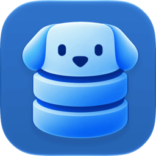
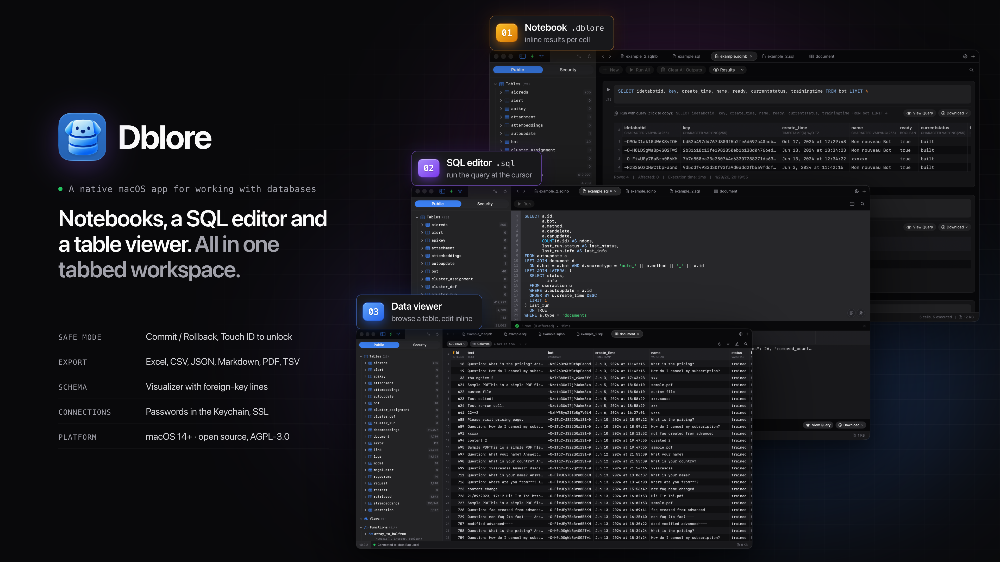

<div align="center">



# Dblore

A native macOS database client: query in Jupyter-style **notebooks** or a classic
**SQL editor**, browse and edit results and tables, explore the schema, guard production
with Safe Mode, and get help from an AI assistant that works with your own key or a local
model. Supports PostgreSQL, MySQL/MariaDB, MongoDB, SQLite and DuckDB (as a plugin).

[Download](https://github.com/dinhanhthi/Dblore/releases/latest) &nbsp;·&nbsp; [Website](https://dblore.dinhanhthi.com)
&nbsp;·&nbsp; macOS 14+ &nbsp;·&nbsp; signed &amp; notarized

</div>

> [!NOTE]
> Dblore is built around my own day-to-day needs, so many features are still missing.
> Need something? [Suggest a feature](https://github.com/dinhanhthi/Dblore/issues/new?template=feature_request.md&title=New%20feature%3A%20&labels=enhancement)
> and I'll consider adding it.



## Features

- **Notebooks and SQL editor**: `.dblore` notebooks with inline results, plain `.sql` tabs
  and quick Markdown notes, in one tidy workspace
- **Schema browser**: tables, columns and types, a quick filter and a canvas with foreign-key
  lines
- **Structure editor**: add, change and drop columns, indexes and keys, with a preview of the
  exact SQL that runs
- **Results grid**: sort, search, filter, edit values inline, add rows from a form, follow
  foreign keys, inspect cells as JSON and pin a result to compare re-runs
- **Charts**: switch any result between grid and chart
- **Import and export**: import CSV, TSV and JSON; export to Excel, CSV, JSON, Markdown, PDF,
  TSV and SQL `INSERT`
- **SQL dump and restore**: dump a PostgreSQL, MySQL/MariaDB or SQLite database to a `.sql`
  file and restore it
- **Safe Mode**: confirmation before destructive statements, Commit / Rollback for pending
  transactions, Touch ID to unlock
- **AI assistant**: write, explain and fix queries with your own key or a local model.
  Nothing runs unless you allow read-only queries, and row values are never sent
- **MCP server**: let AI agents read the connections you allow, read-only and on this Mac
  only. Off by default
- **Keyboard-first**: run cells and queries without leaving the keys, and find any command
  with `Cmd+K`

[All features](https://dblore.dinhanhthi.com/features.html)

## Databases

- **PostgreSQL**: SSL, client certificates, SSH tunnels, read-only mode, and import from
  DBeaver, TablePlus, DataGrip, `.pgpass` or a URI
- **MySQL and MariaDB**: TLS, client certificates, SSH tunnels, staged edits by primary key
  and an EXPLAIN plan tree on MySQL
- **MongoDB**: mongosh commands, editable document cards, a collection screen with filter,
  schema and indexes, and an aggregation builder
- **SQLite**: open a file and work with it like a server connection

## Plugins

Optional engines that are not bundled with the app. Install them from
**Settings > Plugins**: Dblore downloads a signed, notarized library, checks its SHA-256
before every load, and **Remove** deletes it again.

| Plugin | Version | What it adds |
| ------ | ------- | ------------ |
| **DuckDB** | 1.5.6 | Open a `.duckdb` file (read-only by default, also from Finder), create one or use an in-memory database, browse its schema and query Parquet or CSV files |

## Install

- **Download the app:** get the latest signed &amp; notarized DMG from the
  [Releases page](https://github.com/dinhanhthi/Dblore/releases/latest), open it and
  drag Dblore to Applications. From v0.2.0 on, it updates itself
  (**Dblore > Check for Updates…**).
- **Or build from source:** see below.

## Requirements

- macOS 14 or later
- Xcode 27 on macOS 26 (only to build from source)
- A PostgreSQL, MySQL/MariaDB or MongoDB server, or a SQLite or DuckDB file, to connect to

## Build from source

```sh
git clone https://github.com/dinhanhthi/Dblore.git
cd Dblore
open Dblore.xcodeproj      # press Run
```

Headless build / test:

```sh
xcodebuild build -scheme Dblore -destination 'platform=macOS,arch=arm64'
SKIP_INTEGRATION_TESTS=true xcodebuild test -scheme Dblore \
  -destination 'platform=macOS,arch=arm64' -enableCodeCoverage NO
```

`-enableCodeCoverage NO` is required: without it `xcodebuild test` hangs after the tests
finish.

### Local databases

Ready-made Docker servers (PostgreSQL, MySQL/MariaDB, MongoDB and an SSH tunnel stack) to
connect the app to and run the integration tests against. Ports, logins and setup:
[docker/README.md](docker/README.md).

## Contributing

Contributions are welcome: open an issue to discuss a change, or send a pull request.
See **[CONTRIBUTING.md](CONTRIBUTING.md)** for guidelines.

## License

Copyright (C) 2025-2026 Anh-Thi Dinh.

Dblore is open source under the
[GNU Affero General Public License v3.0](https://www.gnu.org/licenses/agpl-3.0.html).
You may use, modify, and distribute it under its terms. See [LICENSE](LICENSE) for the
full license text.
